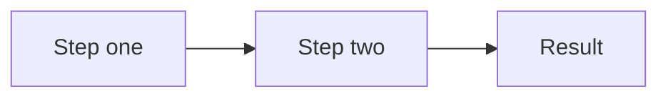

[Home](README.md) › Page title

# Page title

One or two sentences: what this page explains and why it matters.

## How it works

1. Step one, and the file or function that does it (`path/to/file`).
2. Step two.

## Why it is built this way

The reasons, or a link to the entry in [Decisions](decisions.md).

## See also

- [Architecture](architecture.md)
